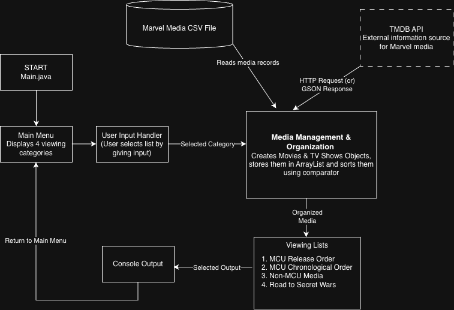

# Marvel Movie & TV Timeline Guide

Java-based console application that organizes MCU and Non-MCU movies and TV shows into viewing lists, including a guide to important titles leading up to Avengers: Doomsday and Avengers: Secret Wars.

## The Problem

Marvel has released numerous movies and TV shows across the MCU and other Marvel universes. For fans who stopped following the MCU after Avengers: Endgame, it can be difficult to understand which titles they should watch to catch up before the upcoming Avengers movies.

Additionally, fans who want to explore Marvel media beyond the MCU may find it difficult to navigate titles across different universes and timelines.

This project aims to organize Marvel media into structured viewing lists so users can easily explore titles and identify important ones to watch.

## How It Works

The application will provide a console-based menu with four main categories:

1. **MCU Movies, TV Shows & Special Presentations in Release Order:** Browse MCU media according to its original release order.
2. **All MCU Media in Chronological Order:** Explore MCU movies, TV shows, and Special Presentations according to the chronological order of their stories.
3. **Non-MCU Media:** Explore Marvel movies and TV shows outside the MCU, organized into relevant sections.
4. **Road to Secret Wars:** Follow a chronological viewing guide featuring important MCU and Non-MCU titles to watch before Avengers: Doomsday and Avengers: Secret Wars.



[Eisenhower Matrix:- ] (docs/eisenhower-matrix.pdf)

## Tech Stack

- **Programming Language:** Java

- **Java Libraries:** ArrayList, Comparator, BufferedReader, PrintWriter, HttpClient

- **External Library:** Gson

- **Data Storage:** CSV

- **External API:** The Movie Database (TMDB) API

- **Development Tools:** Visual Studio Code, Git, GitHub

## Setup

### Prerequisites

- Java Development Kit (JDK)
- Visual Studio Code (recommended)
- Git

### Installation

Clone the repository and navigate to the project directory:

```bash
git clone https://github.com/sushantsaladi7-blip/marvel-movie-tv-guide.git
cd marvel-movie-tv-guide
```
Open the project folder in Visual Studio Code.

## Usage

After starting the application, users will be presented with a main menu containing four categories:

1. MCU Movies, TV Shows & Special Presentations in Release Order
2. All MCU Media in Chronological Order
3. Non-MCU Media
4. Road to Secret Wars

Users can enter the corresponding menu number to select a category and browse its Marvel titles.

Each list will provide relevant information about the titles, such as release dates and viewing importance.

The Road to Secret Wars category will provide a chronological viewing guide to important MCU and Non-MCU titles leading up to Avengers: Doomsday and Avengers: Secret Wars.

## Roadmap

- [ ] Create Java classes to represent MCU and Non-MCU movies and TV shows.
- [ ] Load Marvel media data and store it in the Java classes.
- [ ] Build the main menu for navigating different lists of Marvel media.
- [ ] Implement MCU media lists in release order and chronological order.
- [ ] Implement Non-MCU media lists grouped into relevant sections.
- [ ] Implement the Road to Secret Wars viewing guide for *Avengers: Doomsday* and *Avengers: Secret Wars*.
- [ ] Test the application, fix bugs, and finalize the console interface.

## Author

**Sushant Saladi**

**GitHub:** [sushantsaladi7-blip](https://github.com/sushantsaladi7-blip)
