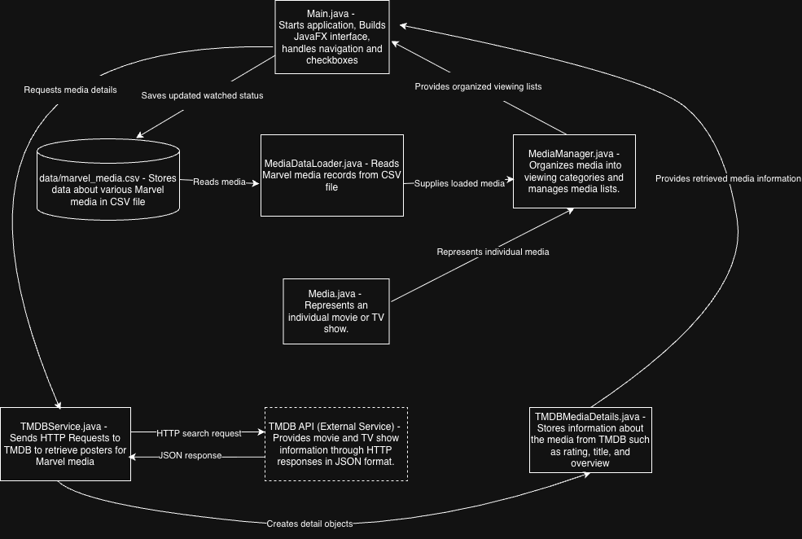

# Marvel Movie & TV Timeline Guide

A Java-based JavaFX application that organizes Marvel movies and TV shows into viewing lists, helping users explore the Marvel Cinematic Universe (MCU) and other Marvel universes, including titles leading up to *Avengers: Doomsday* and *Avengers: Secret Wars*.

## The Problem

Marvel has released numerous movies and TV shows across the MCU and other Marvel universes. For fans who stopped following the MCU after *Avengers: Endgame*, it can be difficult to understand which titles they should watch to catch up before the upcoming Avengers movies.

Additionally, fans interested in exploring Marvel media beyond the MCU may find it difficult to navigate titles across different universes and timelines.

This project addresses these challenges by organizing Marvel media into structured viewing lists, allowing users to explore different categories and track their viewing progress.

## How It Works

The application provides a graphical user interface with four main viewing categories:

1. **MCU Release Order:** Browse MCU movies, TV shows, and Special Presentations according to their original release order.
2. **MCU Chronological Order:** Explore MCU media according to the chronological order of their stories.
3. **Non-MCU Release Order:** Browse Marvel movies and TV shows outside the MCU.
4. **Road to Avengers: Secret Wars:** Follow a viewing guide featuring important MCU and Non-MCU titles leading up to *Avengers: Doomsday* and *Avengers: Secret Wars*.

Users can select a category from the home screen to view its corresponding list of media.

Each title is displayed with its poster and title. Users can mark movies and TV shows as **Watched** or **Not Watched** using checkboxes. Their watched status is saved to the CSV file and persists after closing and reopening the application.

The application also integrates **The Movie Database (TMDB) API** to retrieve movie and TV show posters and additional media information.

## System Architecture



**Eisenhower Matrix:** [View Project Prioritization Matrix](docs/eisenhower-matrix.pdf)

## Tech Stack

- **Programming Language:** Java
- **GUI Framework:** JavaFX
- **Java Libraries and APIs:**
- Java Collections (`ArrayList`)
- `Comparator`
- Java HTTP Client
- File I/O (`BufferedReader`, `PrintWriter`, etc.)
- **External Library:** Gson
- **Build Tool:** Maven
- **External API:** The Movie Database (TMDB) API
- **Data Storage:** CSV files
- **Development Tools:** Visual Studio Code, Git, GitHub

## Setup

### Prerequisites

- Java Development Kit (JDK)
- Apache Maven
- Git
- A TMDB API Read Access Token

### Installation

Clone the repository and navigate to the project directory:

```bash
git clone https://github.com/sushantsaladi7-blip/marvel-movie-tv-guide.git
cd marvel-movie-tv-guide
```

### TMDB API Configuration

The application requires a TMDB API Read Access Token to retrieve media information.

1. Create a TMDB account and obtain an API Read Access Token from your account settings.
2. Set the token as an environment variable in your terminal:

```bash
export TMDB_TOKEN='YOUR_TMDB_READ_ACCESS_TOKEN'
```

3. Keep your token private. Never commit API keys or access tokens to the GitHub repository.

### Running the Application

Run the following command from the project directory:

```bash
mvn clean javafx:run
```

## Usage

1. Launch the application to access the home screen.
2. Select one of the four viewing categories.
3. Browse the corresponding Marvel movies and TV shows.
4. View media posters and titles.
5. Use the checkboxes to mark titles as **Watched** or **Not Watched**.
6. Return to the home screen to explore another category.

Watched status is automatically saved to the CSV file, allowing viewing progress to persist between application sessions.

## Future Plans

Potential improvements for future versions include:

- [ ] Add search functionality.
- [ ] Add advanced filtering options.
- [ ] Create individual movie and TV show detail pages.
- [ ] Add personalized viewing recommendations.

## Author

**Sushant Saladi**

**GitHub:** [sushantsaladi7-blip](https://github.com/sushantsaladi7-blip)
